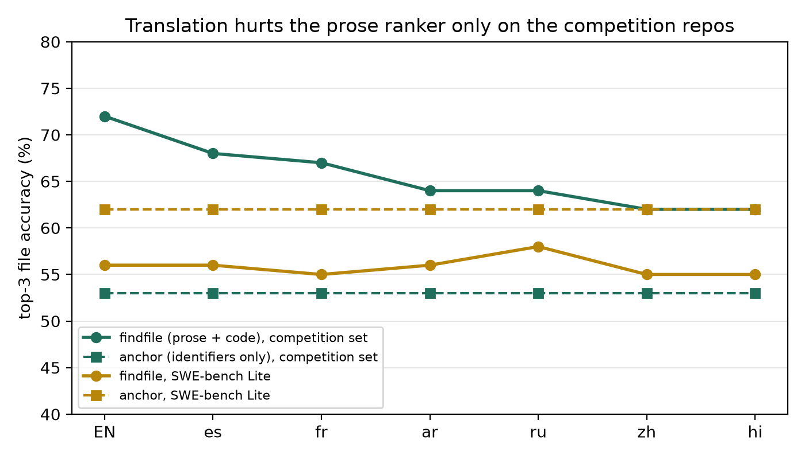
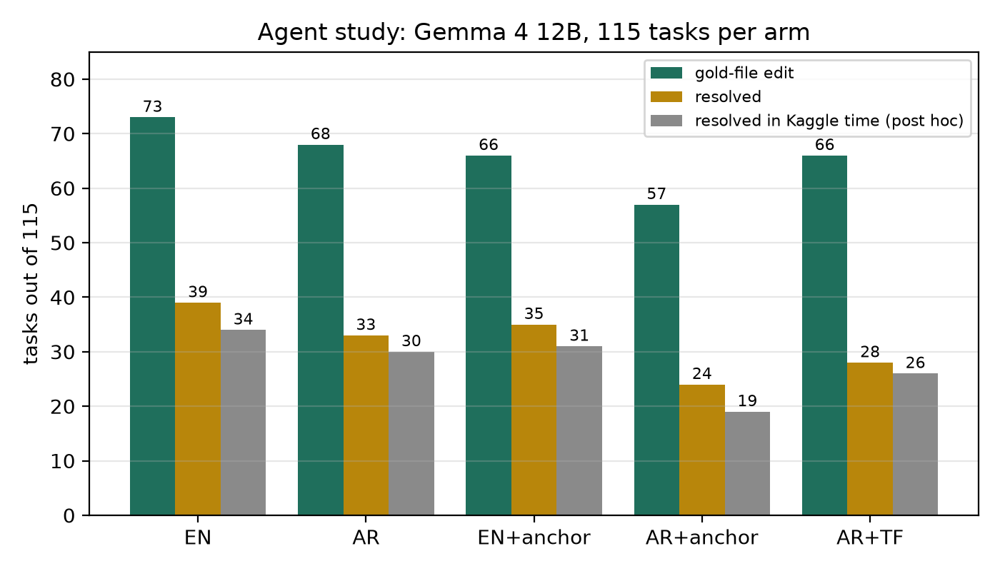

# Non-English Issues Hurt the Retriever, Not the Agent: A Multilingual Test of Code Localization for a Small Local Coding Agent

## Abstract

Most issues in this competition are written in English, but many developers don't write in English. We translated the issue text of the public Gemma 4 dev tasks into six languages (Arabic, Chinese, Hindi, Russian, Spanish, French), keeping code, identifiers and tracebacks byte-identical, and asked two questions. First, what happens to model-free file localizers when the prose changes language? Second, does a small local agent (Gemma 4 12B, 4-bit) get worse on Arabic issues, and does an identifier-only localization skill help it? On the competition repos, a strong prose-aware ranker loses 8 to 10 top-3 points in the four non-Latin-script languages, while identifier-only rankers lose nothing. That loss did not replicate on SWE-bench Lite (296 tasks) or on a pre-registered set of 428 SWE-bench tasks, where the drop was about 1 to 2 points. In a pre-registered agent study (115 tasks × 5 arms, 575 runs), no hypothesis held. The agent lost only 4.3 points of gold-file edits on Arabic issues (interval includes zero), and every point estimate for the localization skill was negative. From the traces, the agent usually finds the right file. It runs out of tool calls before it finishes the edit.

## 1. Introduction

The agents in this competition run offline on small open models, and the issue text is the only thing that tells them where to look. Model-free localizers such as the public findfile notebook rank files by matching issue words against code, and on these repos they work well: 72% top-3 in English. Its own ablation shows that a large part of that comes from plain English words in the issue. Those words are exactly what disappears when the issue is written in Arabic or Hindi. Identifiers usually stay in English, because nobody translates `APIRouter`.

So our starting guess was simple. Prose-based localizers should break on non-English issues, identifier-only ones should not, and giving a small agent an identifier-only "anchor" should close the gap. Only part of this turned out to be true, and the parts that failed taught us more.

What we contribute:

1. Six-language variants of the 129 public task issues, with code masked during translation and restored byte-for-byte, plus an unmasked Arabic control.
2. A cross-lingual audit of eight localizers (Exp A), with an exact reproduction of the public findfile numbers, a signal audit that splits each issue into prose and code parts, and replications on SWE-bench Lite and on a pre-registered SWE-bench set.
3. A pre-registered agent study on Gemma 4 12B: English vs Arabic, with and without the anchor skill, plus a translate-first arm. The SHA-256 of the pre-registration was posted on the forum before any full run.
4. A look at why the anchor hurt, and one follow-up prompt change (bigger reads) that also hurt.

## 2. Related work

SWE-bench and SWE-agent set up the task and the agent loop we use. AutoCodeRover and Agentless localize with an LLM before editing; LocAgent uses BM25 and a code graph. Those cost tokens, and the LLM step depends on the model reading the issue language. Multi-SWE-bench and SWE-bench Multilingual vary the *programming* language, not the language of the issue. Cross-language bug localization has been studied before: CrosLocator machine-translates Chinese bug reports and merges the rankings, and Hayashi et al. tried the same idea on two Japanese industrial projects. Both translate the report, which is close to our translate-first arm. MAPS translates SWE-bench into eleven languages and finds code tasks hold up better than language-heavy ones. In this competition, the findfile notebook (nobanks) gave the IDF ranker we reproduce. The nakranivaibhav repair kit gave the repaired sandbox we run on. Other paper-track releases (hub-prior audit, codegraph-loc, where-the-fix-lives, and jaredga's notebooks) work on localization and verifiability, but none of the ones we read looks at non-English issues.

## 3. Data: the multilingual issue variants

We used the 129 public tasks (fastapi 67, rich 48, requests 13, httpx 1). For localization we scored the 125 tasks whose reference fix touches an existing package file, the same rule findfile uses.

Translation masks every code part before the model sees the text: fenced blocks, inline backticks, tracebacks, URLs, paths, and CamelCase, snake_case and dotted names. The masked prose was translated by DeepSeek (deepseek-flash, thinking off, temperature 0), then unmasked. Every placeholder had to come back exactly once, and 129/129 issues passed after repair turns, with 0 of 41 issue references lost. We call this version MIX. As a control we also made AR-FREE, Arabic with no masking at all. On localization it scored within 1 point of AR-MIX, so the masking does not drive our results.

## 4. Experiment A: which localization signals survive translation

**Setup.** Eight rankers: rarest-term grep (what agents usually do), vote, IDF vote, BM25, findfile tuned, findfile with no word list, findfile on identifiers only, and our anchor. The anchor extracts only language-independent parts (traceback frames, backticked spans, dotted names, CamelCase, snake_case, `.py` paths, `*Error` names). It keeps those that exist in the repo, ranks them, and prints `symbol → file:line`. Gold is the set of non-test files in the reference patch. We report top-3 with paired exact McNemar tests against English.

**Reproduction gate.** Before anything else we reproduced the seven public findfile rankers. All matched the published top-1/3/5/10/miss within 0.4 points.

**English.** findfile tuned 74, findfile no-list 72, BM25 56, findfile identifiers-only 53, anchor 53, IDF vote 50, vote 49, rarest grep 44. The anchor is "blind" (finds no identifier) on 46 of 125 issues (37%).

**Table 1.** findfile (no list) top-3 by language, competition set (125 tasks). Change vs English with exact McNemar p.

| Lang | EN | es | fr | ar | ru | zh | hi |
|---|---|---|---|---|---|---|---|
| top-3 | 72 | 68 | 67 | 64 | 64 | 62 | 62 |
| change | | −4.0 | −4.8 | −8.0 | −8.0 | −9.6 | −10.4 |
| p | | 0.36 | 0.21 | 0.041 | 0.041 | 0.017 | 0.011 |

The four non-Latin-script languages lose 8 to 10 points. Spanish and French lose 4 to 5, which isn't separated from zero. Every identifier-only ranker (anchor, identifiers-only, both votes) gave identical output in all seven versions, with zero discordant tasks. BM25 didn't lose in any language (55 to 60).

*Figure 1. Top-3 file accuracy by issue language. Solid: findfile (no list). Dashed: anchor.*

Invariance didn't make the anchor competitive, though. In Arabic, findfile still beats it by 11.2 points (26 tasks vs 12, p = 0.034). Our plan predicted the anchor would catch up, and it didn't in any language.

**Why findfile keeps 64 in Arabic.** We split each English issue into parts and dropped them one at a time. Full issue 72, prose only 57, code only 58: each half gets about 57, and together they get 72. Dropping inline code costs 8 points (p = 0.013). The anchor depends almost entirely on backticks: without inline code it falls from 53 to 24. When we removed all Arabic letters from AR-MIX, findfile still scored 64. So in Arabic it reads only the Latin-script parts, and the words the translator left in Latin script (library names, English terms) give it 5.6 points over code-only (7 tasks gained, 0 lost, p = 0.016).

**Translate back.** Translating the Arabic and Hindi issues back to English recovers about half the loss (ar 64 → 67, hi 62 → 67). Both are still 4.8 points under English (p = 0.031).

**Replication on SWE-bench Lite.** The competition set is four small repos, and another paper-track release showed that a method can score very differently there and on Lite. So we ran the same audit on 296 Lite tasks, in the same six languages. findfile scored 56 in English and 55 to 58 in every language, none separated (all p ≥ 0.49). The anchor scored 62 in every language, above findfile, which is the reverse of the competition set. The signal audit explains it: on Lite, prose adds only 3 points beyond code (53 → 56, p = 0.31), against 14 on the competition set. Lite issues carry 8.9 bare identifier parts per task against 1.8 on the competition set.

**Pre-registered test of the cause (Part 2).** After Lite, two explanations were confounded: repo size (competition repos are small) and issue style (few identifiers). We pre-registered a test on the SWE-bench test split minus Lite and minus `psf/requests`: 428 tasks, a small stratum (under 100 `.py` files, 128 tasks in 3 repos) and a large one (over 300 files, 300 tasks in 4 repos). The mean loss over six languages was small in both: −2.2 points (small, EN 73.4) and −0.9 (large, EN 63.7).

- S1, the loss is larger in small repos: NOT SHOWN, −1.3 [−9.1, +5.8].
- S2, tasks where prose adds a hit lose more: HOLDS in both strata (−51.8 and −56.0 points). Before reading any number, we found that this test leans toward HOLDS by construction: prose-hit tasks are English hits, so they can only lose. An exploratory comparison of English hits only gives −46.9 and −45.9.
- S3, issues with fewer bare identifiers lose more: NOT SHOWN.

So the conclusion is limited. Where the prose carries the hit, translation takes it away. How often that happens depends on the issue set, and on wider SWE-bench data it is rare enough that the average loss is 1 to 2 points.

## 5. Experiment B+C: does the agent care?

**Pre-registration.** PREREG.md (SHA-256 `b31d8fd93839a2672de664704e7577670a22b7570d39d57e94c328e8865243d7`) was posted on the paper-track forum on 5 Nov, before any full run. Exp A, the signal audit and Lite had already run, so those are exploratory. Only Part 1 (this section) and Part 2 (above) are confirmatory.

**Setup.** Gemma 4 12B QAT (GGUF Q4_0) served locally on an RTX 4070 SUPER, through the competition harness (swegemma 0.2.11) and the repaired sandbox. Temperature 0, seed 42, max output 2,048, thinking budget 1,024, two tasks at a time. Each run got 30 tool calls, 40 turns and a 25-minute hang guard. We used a call budget rather than a time budget because our GPU's speed doesn't match Kaggle's 4×L4. There were five arms on the same 115 tasks: EN, AR (AR-MIX issue), EN+anchor, AR+anchor, and AR+TF, where the same 12B first translates the issue to English and those tokens count. The anchor agent differs from the base only by the skill, a first step that calls it, and one line about its arguments. The primary metric is gold-file edit recall: does the final diff touch a non-test gold file? Verdicts were set in advance. HOLDS means the test passes after Holm correction. FAILS means the 90% interval lies inside ±10 points. NOT SHOWN covers everything else.

All 575 runs finished in 49.6 run hours, under the 60-hour stop. Fifteen first tries were aborted by the server (11 tool-call parse errors, 4 other HTTP 400s) and rerun once, as registered. Counting those aborts as failures gives the same four verdicts.

**Table 2.** Agent results, 115 tasks per arm.

| Arm | Gold-file edits | Resolved | Resolved in Kaggle time* |
|---|---|---|---|
| EN | 73 | 39 | 34 |
| AR | 68 | 33 | 30 |
| EN+anchor | 66 | 35 | 31 |
| AR+anchor | 57 | 24 | 19 |
| AR+TF | 66 | 28 | 26 |

\*Exploratory: each run scored after the fact against a 330-second cap modelled on the 12B's speed on Kaggle 4×L4.

*Figure 2. Agent results per arm.*

**Table 3.** Pre-registered tests, gold-file edit recall (paired difference, 90% interval).

| | Claim | Effect (points) | Verdict |
|---|---|---|---|
| H1 | Arabic lowers recall | −4.3 [−12.2, +3.5] | NOT SHOWN |
| H2 | Anchor raises English recall | −6.1 [−13.9, +1.7] | NOT SHOWN (wrong way) |
| H3 | Anchor shrinks the EN−AR gap | −3.5 [−13.9, +7.0] | NOT SHOWN (wrong way) |
| H4 | AR+anchor non-inferior to AR+TF | −7.8 [−15.7, 0.0] | NOT SHOWN |

All Holm-adjusted p = 1.0. Total tokens: AR+anchor 295,813 per task vs AR+TF 277,184 including translation (Wilcoxon p = 0.030), so the anchor wasn't cheaper either. Running the same 10 tasks again matched on 9/10 in English and 7/10 in Arabic. Turns to the first gold-file read were close in every arm (6.1 to 8.1, no Wilcoxon p under 0.33).

We wrote down before the data what an H1 non-result would mean: if the ranker loss doesn't reach the agent, the agent absorbs it, and H3 can't be read as a repair. That is where we ended up. Arabic cost the agent an estimated 4 points, which we can't separate from zero. The localization skill didn't help in either language, and its point estimates are all negative.

## 6. Why the anchor didn't help (exploratory)

The anchor's output was fine. Its top 3 held a gold file on 83/115 English and 68/115 Arabic tasks. The agent without it already found the file anyway: in the EN arm it read a gold file in 103 of 115 tasks, usually on its first read. What changed was how the agent spent its 30 calls. With the anchor it read more (14.0 vs 12.2 reads per task), hit the call budget more often (70 vs 64 runs), and made any edit at all on far fewer tasks (EN 73 vs 91, AR 71 vs 91). This held even on tasks where the anchor was right. Our reading is that an 8-line list of candidates, together with a skill telling it to "check the next two", sends a small model off exploring.

The failures in the EN arm look like this: 39 resolved, 34 edited a gold file but failed the tests, 31 never edited anything, and 11 edited the wrong file. Of the 31 never-edited runs, 29 ended on the call budget, and several final messages say the fix is known but calls ran out. Only 5 tasks were never edited in all five arms, so it isn't a fixed set of impossible tasks. About 38% of reads covered lines the agent had already read.

That pointed at reading, so we tried smaller anchor displays in short smoke runs (8 tasks, then 30), and they stayed within noise of no anchor. Then we tried one prompt change on all 115 English tasks: read 200 lines per call and never re-read. It made things worse: 30 resolved vs 39 (23 vs 34 inside the Kaggle cap), and 58 runs on the budget limit vs 43. Per task: 23 both solved, 16 only the old prompt, 7 only the new one (sign test p ≈ 0.09). Lines per read doubled, but the number of reads didn't drop. This run was not pre-registered.

## 7. Discussion and limitations

The retrieval results and the agent results don't agree, and that is our main finding. A retriever that ranks files once from the issue text loses real accuracy when the issue language changes, on repos where the prose does the work. An agent that can grep, read and run code gets a second chance at every step, mostly through the identifiers that stay in English, and on these tasks it absorbs most of that loss. For people building offline agents for non-English users, translating the issue first or adding a localization tool are not obviously worth it at 12B. Both cost tokens and calls, and neither beat doing nothing here. What needs fixing is what the agent does after it finds the file.

Limitations, roughly in order of how much they worry us:

- One model (12B, Q4_0) on a local server, not the scorer's vLLM W4A16. The server's tool-call parser differs, and on Kaggle known edit-argument bugs may change things. One seed per arm; the retest shows that 1 to 3 of 10 tasks flip between identical runs.
- 115 tasks gives intervals about ±8 points wide, so effects under that size are NOT SHOWN, not absent.
- The agent study is Arabic only. The translations are machine translations. We planned a native-reader check and a back-translation drift check and did neither. MIX keeps code intact, and real non-English issues may translate or transliterate identifiers. In that case the anchor would go blind and the agent could do worse than here.
- Four repos for the agent study, all Python.
- One correction to the pre-registration: it says the largest pilot prompt was 16,921 tokens, but that is the AR+TF arm's maximum. Over all pilot runs it was 36,985. This changes no setting, test or verdict.
- We have no hidden-test number. Our one submission timed out without a score.

## 8. Reproducibility

Repository: [github.com/muhandalsaiari/araswe-sandbox](https://github.com/muhandalsaiari/araswe-sandbox/tree/araswe) (branch `araswe`). It holds the pre-registration and task lists (`tools/araswe_anchor/paper/`), the agents for all arms (`agents/`), the per-run ledger (`results/task_runs.jsonl`), the verdict files and every agent trace from the study (`results/paper/`), and the scripts behind each number (`eval_localization.py`, `paired_test.py`, `signal_audit.py`, `part2_read.py`, `paper_read.py`, `paper_secondary.py`). As the host allowed, translations are released as prose with code placeholders, keyed by `instance_id` (`results/paper/translations/`, 773 issues; Chinese has 128 because one issue failed translation twice). `release_translations.py restore` rebuilds the full text from the competition's own `tasks.jsonl` and checks each issue against a SHA-256, and all 773 round-trip byte for byte. For SWE-bench we ship task ids and numbers only.

Translations were made with DeepSeek. Code and analysis were written with help from Claude. All experiments were designed, run and checked by the author.

## References

- Jimenez et al. SWE-bench: Can Language Models Resolve Real-World GitHub Issues? ICLR 2024.
- Yang et al. SWE-agent: Agent-Computer Interfaces Enable Automated Software Engineering. 2024.
- Zhang et al. AutoCodeRover: Autonomous Program Improvement. arXiv:2404.05427.
- Xia et al. Agentless: Demystifying LLM-based Software Engineering Agents. 2024.
- Chen et al. LocAgent: Graph-Guided LLM Agents for Code Localization. arXiv:2503.09089.
- Zan et al. Multi-SWE-bench. 2025. / SWE-bench Multilingual. 2025.
- Robertson and Zaragoza. The Probabilistic Relevance Framework: BM25 and Beyond. 2009.
- nobanks. LocBench + findfile. Kaggle notebook, 2026.
- nakranivaibhav. gemma-4-developer-agent repair kit. GitHub, 2026.
- Xia, Lo, et al. Cross-language bug localization (CrosLocator). ICPC 2014, 275–287.
- Hayashi, Kobayashi, Kato. Evaluation of Cross-Lingual Bug Localization: Two Industrial Cases. ICSME 2023, 495–499. arXiv:2310.01803.
- Hofman et al. MAPS: A Multilingual Benchmark for Agent Performance and Security. EACL 2026 Findings. arXiv:2505.15935.
